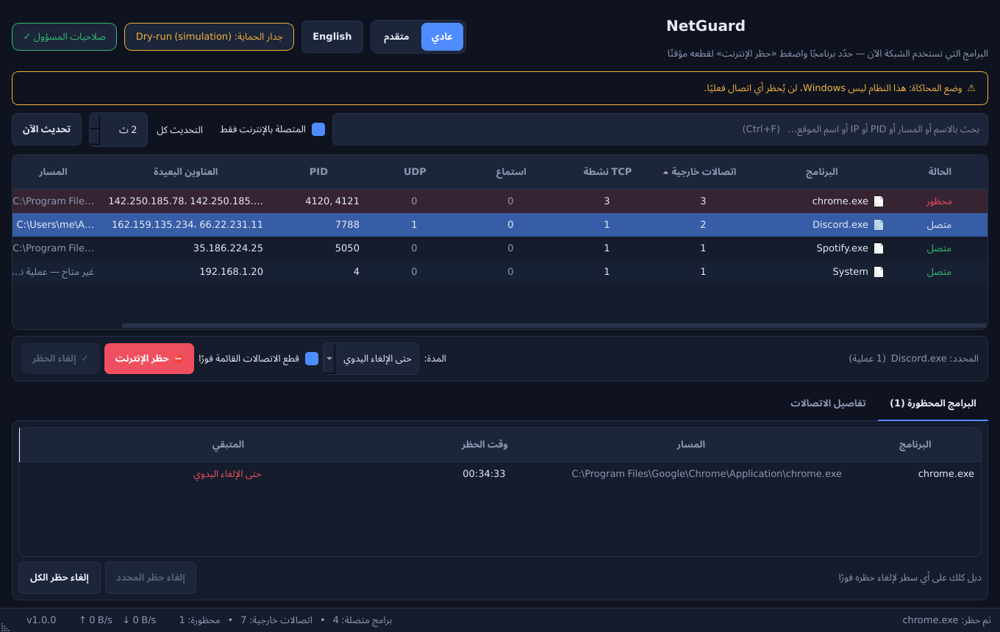
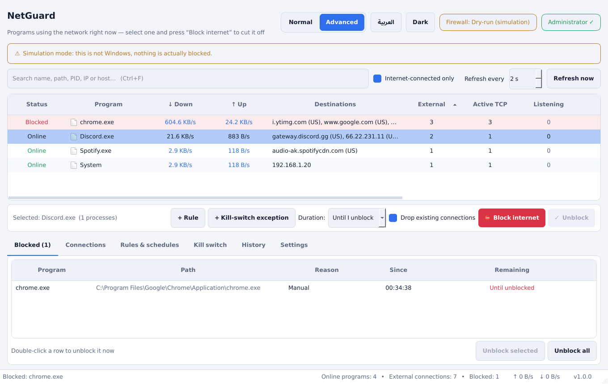

# NetGuard

Windows desktop app that lists every program using the network and cuts a program's
internet access temporarily, on a schedule, or permanently. Arabic and English UI
(live switch, RTL/LTR), dark and light themes.

| Normal mode | Advanced mode |
|---|---|
|  |  |

## Two modes

**Normal** — the simple tool: live list of programs with network connections, block /
unblock with a duration (1 min → 3 h, custom, or until you lift it), optional immediate drop
of existing connections, connection details.

**Advanced** — everything in Normal, plus:

| Feature | How it works |
|---|---|
| Per-program speed (↓/↑) | Windows TCP Extended Statistics (`SetPerTcp[6]ConnectionEStats` / `GetPerTcp[6]ConnectionEStats`), byte-counter deltas per connection summed per program. TCP only; UDP has no per-socket counters on Windows. |
| Destinations: host names + countries | Host names from the Windows DNS client cache (`Get-DnsClientCache`, i.e. the name the program actually looked up), then reverse DNS. Countries are **opt-in**: public IPs only are sent to `https://api.country.is` in batches, cached on disk. |
| Rules & schedules | Permanent rules or day/time windows (e.g. Thu–Fri 23:00 → 06:00, crossing midnight). Rules keep working in Normal mode. A program stays blocked while *any* reason applies (manual and/or rule). |
| Kill switch | Sets every firewall profile's default outbound action to Block and adds allow rules for your exceptions. The original defaults are saved **before** the change and restored on turn-off, on exit, or after a crash. Windows' built-in core-networking rules (DNS, DHCP) stay active. |
| Microsoft Store apps | AppContainer apps are detected from the process token (`TokenAppContainerSid`) and blocked with `New-NetFirewallRule -Package <SID>`; program-path rules don't apply to them. |
| History | SQLite log of blocks, unblocks, expiries, rules and kill-switch events + per-day traffic totals per program (today / 7 / 30 days). Retention configurable. |
| Tray + notifications | Close to tray, tray menu (show, kill switch, unblock all, quit), notifications when blocks expire or rules start/end. |
| Start with Windows | Task Scheduler logon task with highest privileges (no UAC prompt at logon), runs on battery, no time limit, starts minimized. |
| Theme | Dark / light. |

## How blocking works

```
NetGuard-<id>-Out    dir=out  action=block   program="<exe>"   (or -Package <SID>)
NetGuard-<id>-In     dir=in   action=block   program="<exe>"
NetGuard-<id>-Allow  dir=out  action=allow   program="<exe>"   (kill-switch exception)
```

`<id>` = first 12 hex chars of SHA-1 of the normalized path. Block rules beat allow rules.
`netsh` and PowerShell are called by absolute `System32` path; PowerShell scripts are passed
with `-EncodedCommand`; program paths, SIDs and profile values are validated before use.
All state (`state.json`, `policies.json`, `killswitch.json`, `settings.json`,
`history.sqlite3`) lives in `%APPDATA%\NetGuard`. On start NetGuard reconciles that state with
the firewall: expired blocks are removed, active ones re-applied, orphan `NetGuard-*` rules
deleted, and an interrupted kill switch restored.

## Run

Windows 10/11, Python 3.10+:

```bat
run.bat
```

The app asks for administrator rights (UAC); without them it opens read-only.

### Build the .exe

```bat
build.bat            → dist\NetGuard.exe  (single file, UAC manifest, app icon)
```

Or push a tag `v*` / run the **Build Windows exe** workflow on GitHub: it runs the tests on
`windows-latest` and uploads `NetGuard.exe` as an artifact.

## Limitations

- Processes whose path can't be read (`System`, some protected services) can't be blocked.
- Blocking is per executable: it affects every instance of that program.
- Dropping existing connections works for IPv4 TCP; Windows has no API for IPv6.
- Speed and usage cover TCP only.
- If Windows Firewall is off for a profile, rules have no effect there (a banner warns you).
- On a domain-managed PC, Group Policy can override firewall defaults (kill switch).

## Development

On Linux/macOS the app runs against a simulated firewall, so the UI and logic can be
developed and tested anywhere.

```bash
pip install -r requirements.txt pytest
QT_QPA_PLATFORM=offscreen pytest -q
```

```
main.py                      entry: UAC elevation, single instance, logging, wiring
netguard/monitor.py          psutil snapshot → per-exe groups
netguard/bandwidth.py        TCP EStats per-program speed
netguard/hostnames.py        DNS-cache / PTR host names, country lookup
netguard/firewall.py         WindowsFirewall (netsh/PowerShell) + DryRunFirewall
netguard/blocker.py          manual + rule-driven blocks, expiry, persistence, restore
netguard/policies.py         permanent / scheduled rules
netguard/killswitch.py       kill switch with crash-safe restore
netguard/history.py          SQLite events + usage
netguard/win_appcontainer.py Store-app package SID from the process token
netguard/autostart.py        Task Scheduler logon task
netguard/tcp_killer.py       drop existing IPv4 TCP connections
netguard/i18n.py, strings.py Arabic / English
netguard/ui/                 window, models, tabs, dialogs, tray, theme, workers
```

Logs: `%APPDATA%\NetGuard\netguard.log`.
